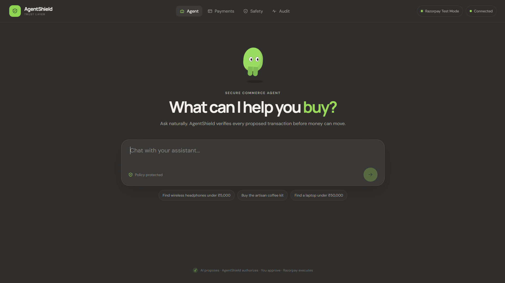

<p align="center">
  
</p>

<h1 align="center">AgentShield</h1>

<p align="center">
  <strong>Trust &amp; Reliability Layer for Agentic Commerce</strong>
</p>

<p align="center">
  AI can propose. Deterministic systems authorize. Razorpay executes.
</p>

<p align="center">
  <a href="#demo">Demo</a> •
  <a href="#why-agentshield">Why AgentShield?</a> •
  <a href="#how-it-works">How It Works</a> •
  <a href="#key-features">Key Features</a> •
  <a href="#getting-started">Getting Started</a> •
  <a href="#api">API</a> •
  <a href="./CONTRIBUTING.md">Contributing</a>
</p>

---

## Built for Razorpay AI Builder 2026

**Track:** AI Growth & Agentic Commerce

AgentShield is an open-source safety and reliability layer for AI-powered commerce. It sits between an AI agent and payment execution, ensuring that an agent can **recommend and propose actions without getting unrestricted authority to move money**.

- The agent **proposes**.
- AgentShield **decides**.
- The customer **approves**.
- Razorpay **executes**.

---

## Demo

<p align="center">
  <a href="https://youtu.be/rWPqCKrf7cY">
    
  </a>
</p>

<p align="center">
  <strong>▶ Watch the AgentShield Demo</strong>
</p>

The demo walks through the complete AgentShield flow end to end:

**Customer → AI Agent → Policy Validation → Human Approval → Razorpay Test Payment → Reconciliation → Audit Trail**

---

## Why AgentShield?

AI agents are becoming capable of taking real actions — including purchasing products, applying discounts, creating orders, and initiating payments.

The problem is simple:

> **Should an AI agent be trusted with unrestricted financial authority?**

AgentShield introduces a deterministic control layer between **AI decision-making** and **financial execution**. Instead of letting an AI model directly trigger a payment, every proposed action passes through an independent policy engine before a human ever sees an approval prompt.

```text
AI Agent
   ↓
Action Proposal
   ↓
AgentShield Policy Engine
   ↓
ALLOW / BLOCK / REVIEW
   ↓
Human Approval
   ↓
Razorpay Test Mode
```

This separates reasoning from authorization.

### What AgentShield protects against

AgentShield validates every proposed financial action against deterministic rules, including:

- 💰 Maximum transaction limits
- 📦 Product availability
- 🏷️ Discount validation
- 🔐 Permission requirements
- 👤 Human approval requirements
- 🔐 Authenticated user sessions and role-based access
- 🔁 Duplicate payment protection
- 🧾 Server-authoritative order totals
- 🔄 Payment reconciliation
- 📋 Complete audit history

The AI does not get to override these checks.

---

## How It Works

```text
┌──────────────┐
│   Customer   │
└──────┬───────┘
       ↓
┌──────────────┐
│   AI Agent   │
└──────┬───────┘
       ↓
┌─────────────────────┐
│   Action Proposal    │
└──────────┬───────────┘
           ↓
┌───────────────────────┐
│      AgentShield      │
│  Policy Validation    │
└──────────┬─────────────┘
           ↓
      ALLOW / BLOCK
           ↓
┌───────────────────────┐
│    Human Approval     │
└──────────┬─────────────┘
           ↓
┌───────────────────────┐
│   Razorpay Test Mode  │
└──────────┬─────────────┘
           ↓
┌───────────────────────┐
│ Webhook / Recovery &  │
│    Reconciliation     │
└──────────┬─────────────┘
           ↓
┌───────────────────────┐
│     Audit Trail       │
└───────────────────────┘
```

### Example agent flow

```text
Customer:   "Recommend something for my morning coffee."
                            ↓
AI Agent:   Recommends a product and proposes an action.
                            ↓
AgentShield: Validates price, inventory, policy limits,
             discounts, and approval requirements.
                            ↓
AgentShield: ALLOW
                            ↓
Human:      Approves the payment.
                            ↓
Razorpay:   Payment Link created.
                            ↓
Customer:   Completes payment in Razorpay Test Mode.
                            ↓
AgentShield: Reconciles payment state.
                            ↓
Audit:      Records the complete action history.
```

---

## Key Features

### 🤖 AI-Powered Commerce
The AI agent can:
- Understand customer requests
- Search the product catalog
- Recommend products and suggest cross-sells
- Generate structured action proposals

### 🛡️ Deterministic Policy Enforcement
AgentShield independently validates every proposed financial action against:
- Price
- Inventory
- Transaction limits
- Discounts
- Permissions
- Approval requirements
- Duplicate actions

### ✋ Human Approval Gate
Financial actions requiring approval cannot bypass the approval step. The AI proposes the action, a human explicitly authorizes it, and only then can payment execution proceed.

### 💳 Razorpay Test Mode
Approved actions can create Razorpay Payment Links in Test Mode. AgentShield never trusts the AI-generated amount as the final financial authority — the server verifies the authoritative order state before creating the payment.

### 🔄 Payment Reconciliation
Payment state is reconciled against Razorpay so that redirect failures, delayed webhooks, or uncertain payment states do not silently produce incorrect local state.

#### Webhook retries and recovery

Verified webhook event IDs are stored durably before processing. Events move through `PENDING`, `PROCESSING`, `PROCESSED`, and `RETRYABLE_FAILURE`; a processing claim expires after 60 seconds so a later delivery can recover work abandoned by a crashed process. In-progress duplicates receive a retryable response, and payment events whose order is not yet available are not marked complete. Audit entries for a provider event are idempotent.

Order updates use conditional state transitions: `PAID` can supersede `FAILED` or recovery states, while a late failure cannot move a paid order backwards. Reconciliation claims `UNKNOWN` orders and may reclaim `RECOVERING` claims after 120 seconds; it checks Razorpay before creating another payment link. This is recoverable, at-least-once processing, not a distributed exactly-once guarantee: the order, action, audit, and webhook records are separate MongoDB writes.

The application initializes the unique webhook-event and idempotent-audit indexes at database connection time. Ensure the application can create/verify these indexes before deploying the new version. Historical webhook rows without retained payload data are treated as already processed and cannot be replayed automatically.

### 📋 Audit Trail
Every important event is recorded throughout the lifecycle:

```text
Action Proposed → Action Validated → Action Approved →
Payment Created → Payment Updated → Payment Reconciled
```

This makes the system inspectable and debuggable.

---

## Tech Stack

| Layer      | Technology                  |
|------------|------------------------------|
| Frontend   | React + TypeScript           |
| Backend    | Node.js + Express + TypeScript |
| Database   | MongoDB + Mongoose           |
| AI         | LLM API                      |
| Payments   | Razorpay Test APIs           |
| Build Tool | Vite                          |
| Runtime    | Node.js                       |

---

## Project Structure

```text
AgentShield/
│
├── client/                 # React frontend
├── server/                 # Express + TypeScript backend
├── AGENTSHIELD_SRS.md      # Software requirements specification
├── README.md
├── CONTRIBUTING.md
└── assets/
    ├── logo.png
    └── demo.mp4
```

---

## Getting Started

### Prerequisites

- Node.js 22 (used by CI and the Docker build stages; the backend manifest declares `>=18`)
- npm (included with Node.js)
- MongoDB 7.0 for local development, or Docker Desktop / Docker Engine with Compose v2
- Razorpay Test Mode API credentials only if you want to make actual test-mode payment-link requests
- An OpenAI-compatible LLM API key is optional; without one, the deterministic fallback agent is used

### 1. Clone the repository

```bash
git clone https://github.com/bhaveshdesale/AgentShield.git
cd AgentShield
```

### 2. Install dependencies

```bash
cd server && npm ci
cd ../client && npm ci
```

In PowerShell, use `Set-Location server; npm ci`, then `Set-Location ..\client; npm ci`.

### 3. Configure the backend

Copy the example file and set `MONGODB_URI` to a local development database. The example uses port `5050`; if `PORT` is omitted, the application defaults to `5000`.

```bash
cp server/.env.example server/.env
```

PowerShell equivalent: `Copy-Item server\.env.example server\.env`.

At minimum, configure `MONGODB_URI`. The example sets `CLIENT_URL=http://localhost:5173`, `PORT=5050`, and `RAZORPAY_MODE=test`; the Razorpay credential and webhook-secret fields are intentionally blank. Payment-link creation requires matching test API credentials. Webhook verification requires the test webhook secret. Keep credentials in the ignored local `.env`, never in source control.

`LLM_API_KEY` is optional. When set, the backend uses an OpenAI-compatible chat-completions API; `LLM_BASE_URL` and `LLM_MODEL` can optionally override the default endpoint and model. The API key name is `LLM_API_KEY` (not `OPENAI_API_KEY`). If no LLM key is configured, the application uses its clearly identified deterministic fallback; this is useful for local setup and tests.

For local development, point `MONGODB_URI` at a disposable database such as `mongodb://127.0.0.1:27017/agentshield_dev`. Keep test data isolated in a separate database, for example `agentshield_test`; backend integration tests use `MONGODB_TEST_URI` when set and otherwise may use `MONGODB_URI`. Never point either variable at shared or production data. MongoDB must already be running locally, or be provided by a local MongoDB/Docker setup.

### Optional frontend API override

The client defaults `VITE_API_BASE_URL` to `/api`, which the Vite development server proxies to `http://localhost:5050`. No frontend environment file is required for the default local setup. To override the API base URL, copy the example and edit `client/.env`:

```bash
cp client/.env.example client/.env
```

PowerShell equivalent: `Copy-Item client\.env.example client\.env`. Vite exposes `VITE_` variables to frontend code; do not put credentials or secrets in this file.

### 4. Provision the first administrator

From the server directory, run the interactive CLI:

```bash
cd server
npm run provision-user
```

PowerShell from the repository root: `Set-Location server; npm run provision-user`.

Enter the email, select `admin`, and enter and confirm a password of 12–256 characters. Password entry is hidden and the CLI requires an interactive terminal. Repeat to create `approver` or `viewer` accounts. There is no public registration endpoint. Use a disposable local database for setup and do not share provisioned credentials.

### 5. Seed the local demo catalog (optional)

The seed script creates a demo merchant and catalog, but first deletes **all merchant and product records** in the configured database. Run it only against a fresh, disposable local development database when you want the demo catalog; do not run it against shared or production data.

```bash
cd server
npm run seed
```

### 6. Start the backend

```bash
cd server
npm run dev
```

The API listens on `http://localhost:5050` with the supplied example configuration. Check database readiness at `http://localhost:5050/api/health`; it returns `200` when MongoDB is connected and `503` otherwise.

### 7. Start the frontend

In a second terminal:

```bash
cd client
npm run dev
```

Open `http://localhost:5173`. Vite forwards `/api` requests to `http://localhost:5050`. For the Docker Compose setup, see [Docker Compose (local development)](#docker-compose-local-development) below.

---

## Safety Model

The central design principle is:

> **AI proposes. Deterministic systems authorize.**

AgentShield intentionally keeps financial authorization outside the LLM. The model can produce an action proposal, but it cannot:

- Change server-side policy
- Override transaction limits
- Modify authoritative order totals
- Bypass required approval
- Mark a payment as successful without verification

This creates a clear boundary between AI reasoning and financial execution.

### Failure Handling

AgentShield is designed to fail safely before money moves.

If a proposal exceeds a transaction limit, uses unavailable inventory,
contains an invalid quantity, or violates another policy, it is blocked
before payment execution.

For uncertain payment states caused by redirects, delayed webhooks, or
external failures, AgentShield uses reconciliation and recovery instead
of blindly retrying the payment.

This ensures that failures do not silently turn into duplicate or
unauthorized transactions.

---

## API
The backend exposes the application flow through the following endpoints:

```http
POST   /api/auth/login
GET    /api/auth/session
POST   /api/auth/logout

POST   /api/agent/chat

GET    /api/products
GET    /api/products/:id

POST   /api/actions/validate
POST   /api/actions/approve

POST   /api/payments/create
GET    /api/payments
GET    /api/payments/:id/status

POST   /api/webhooks/razorpay

GET    /api/audit
GET    /api/dashboard/stats

POST   /api/simulation/run

GET    /api/health
```

The health endpoint and login are public. Application routes require an authenticated session; state-changing authenticated requests also require a CSRF token. The Razorpay webhook is unauthenticated at the session layer but requires a valid signature over the exact raw body and a mode-specific webhook secret.

---

## Testing

From the repository root, `npm test` runs both the client and server test suites. The client suite needs no backend services. The server suite requires a running, disposable MongoDB test database; set `MONGODB_TEST_URI` to that database and configure dummy Razorpay test values as shown below before running the combined command. To run only the client tests, use `npm run test:client`.

Backend tests use a disposable MongoDB test database and dummy Razorpay credentials; provider requests in the automated tests are mocked. Do not use the persistent Compose database, real customer data, or live payment credentials. MongoDB must be running locally (or provide another disposable MongoDB test instance).

PowerShell:

```bash
Set-Location server
$env:NODE_ENV = "test"
$env:MONGODB_TEST_URI = "mongodb://127.0.0.1:27017/agentshield_test"
$env:MONGODB_URI = $env:MONGODB_TEST_URI
$env:RAZORPAY_MODE = "test"
$env:RAZORPAY_KEY_ID = "rzp_test_local_dummy"
$env:RAZORPAY_KEY_SECRET = "local-dummy-api-secret"
$env:RAZORPAY_TEST_WEBHOOK_SECRET = "local-dummy-webhook-secret"
Remove-Item Env:LLM_API_KEY -ErrorAction SilentlyContinue
npm test
npm run lint
npm run typecheck
npm run build
npm audit --audit-level=low
```

Portable shell equivalent (run from `server/`):

```bash
env -u LLM_API_KEY NODE_ENV=test \
  MONGODB_TEST_URI=mongodb://127.0.0.1:27017/agentshield_test \
  MONGODB_URI=mongodb://127.0.0.1:27017/agentshield_test \
  RAZORPAY_MODE=test RAZORPAY_KEY_ID=rzp_test_local_dummy \
  RAZORPAY_KEY_SECRET=local-dummy-api-secret \
  RAZORPAY_TEST_WEBHOOK_SECRET=local-dummy-webhook-secret \
  npm test && npm run lint && npm run typecheck && npm run build
```

Frontend checks (run from `client/`):

```bash
npm ci
npm run lint
npm test
npm run test:coverage
npm run typecheck
npm run build
npm audit --audit-level=low
```

The tracked `.github/workflows/ci.yml` defines dependency audits, backend and frontend linting, typechecks, production builds, the backend test suite, and frontend tests with coverage. It uses Node.js 22, lockfile-based `npm ci`, and a disposable MongoDB service with dummy Razorpay test credentials. The workflow definition is not proof of a successful remote run; verify the workflow run in GitHub before treating CI as a passed release gate.

### Release readiness checklist

The repository does not define release tags, package publishing, or production deployment. Use the repository-specific [release handoff checklist](./RELEASING.md) to review CI-equivalent checks, image limitations, deployment-only security and data-protection gates, and a payment-safe rollback plan. It distinguishes verified repository behavior from checks that require real deployment infrastructure; completing local tests alone does not establish production readiness.

### Docker Compose (local development)

Prerequisites: Docker Desktop (or Docker Engine) with the Docker Compose v2 plugin.

Start the application and MongoDB:

```bash
docker compose up --build
```

Open the frontend at `http://localhost:8080`. The browser sends `/api` requests to that same origin; Nginx forwards them inside the Compose network to the backend. The browser does not need to resolve the Docker-only backend hostname. Compose configures one trusted proxy hop for client-IP rate limiting; the backend remains unpublished. API endpoints are available under `http://localhost:8080/api/` (for example, `/api/health`).

Login throttling currently uses the default process-local memory store from `express-rate-limit`. The counter is effective within a single backend process but is not shared across replicas and resets when a process restarts. Configure a shared rate-limit store at the deployment layer before running multiple backend instances; no shared store is configured by this repository.

Compose uses a persistent MongoDB volume and safe Razorpay test-mode dummy credentials by default. To use local Razorpay test credentials or an LLM key, set `RAZORPAY_KEY_ID`, `RAZORPAY_KEY_SECRET`, `RAZORPAY_TEST_WEBHOOK_SECRET`, or `LLM_API_KEY` in the shell or an ignored root `.env` file before starting. Never put live credentials in the local Compose configuration; Compose fixes `RAZORPAY_MODE` to `test`.

View logs with `docker compose logs -f`; stop the stack with `docker compose down`. To erase the local MongoDB data and start fresh, run `docker compose down -v` **only after confirming you no longer need that data**—removing the named volume permanently deletes the stored database.

For local diagnostics, check service state and readiness with:

```bash
docker compose ps
curl -i http://localhost:8080/api/health
docker compose logs --tail=100 backend mongo
```

The health endpoint returns `200` when MongoDB is connected and `503` otherwise. If the backend does not become healthy, inspect the backend and MongoDB logs for connection or index-initialization failures and verify MongoDB is healthy before restarting the backend with `docker compose restart backend`. Each HTTP response includes an `X-Request-ID`; use that value to find the corresponding backend request and error log entries. Shutdown signals are logged by the backend, which closes its HTTP server before disconnecting from MongoDB.

Run tests from the host with `cd server && npm test`; they require `MONGODB_TEST_URI` pointed at a disposable test database and dummy Razorpay test-mode values. Do not point tests at the persistent Compose development database.

This Compose file is for local development, not production. Its MongoDB service has no authentication and is only reachable on the internal Compose network. Production deployments must configure MongoDB authentication, TLS, backups, network access controls, and managed secrets separately. Serve the application behind HTTPS and configure the backend's production `CLIENT_URL` and explicit Razorpay live-mode settings only in an intentionally secured production environment. The backend waits for MongoDB, creates/verifies its model indexes before listening, reports database readiness through `/api/health`, and drains HTTP requests on `SIGTERM` before disconnecting.

---

## Hackathon Context

AgentShield was built for the **Razorpay AI Builder Internship 2026** challenge, under the **AI Growth & Agentic Commerce** track.

The project explores a practical question for the next generation of AI-powered commerce:

> How do we allow AI agents to participate in transactions without giving them unrestricted financial authority?

AgentShield approaches this through policy enforcement, explicit approval, payment verification, reconciliation, and auditability.

---

## Scope

### Included
- AI-assisted product discovery
- Structured action proposals
- Deterministic policy validation
- User authentication, sessions, CSRF, and role-based access
- Human approval
- Razorpay Test Mode payments
- Payment reconciliation
- Audit logging
- Simulation scenarios
- Commerce dashboard

### Intentionally out of scope
- Production payment processing
- Public self-service registration
- Multi-tenant infrastructure
- Automated refunds
- Payouts
- Subscriptions
- WhatsApp / voice integrations
- Custom fraud ML
- Kubernetes / microservice infrastructure

The goal is to keep the prototype focused on the trust boundary between AI agents and financial execution.

User login, eight-hour sessions, logout revocation, CSRF validation, role checks (`admin`, `approver`, `viewer`), and interactive account provisioning are implemented. Razorpay integration is configurable and supports guarded live-mode settings, but local development and automated tests use test-mode configuration and mocked provider calls. No production deployment or live payment operation is established by this repository.

---

## Roadmap

- [x] AI agent interaction
- [x] Product recommendations
- [x] Structured action proposals
- [x] Deterministic policy validation
- [x] Human approval gate
- [x] Razorpay Test Mode integration
- [x] Payment status reconciliation
- [x] Audit trail
- [x] Payment history
- [x] Simulation scenarios
- [ ] Public hosted demo
- [ ] Expanded policy configuration
- [ ] More agentic-commerce integrations

---

## Contributing

See [CONTRIBUTING.md](./CONTRIBUTING.md) for how to propose changes, report bugs, and submit pull requests.

---

## Security

Please never commit:

- API keys
- Razorpay secrets
- Database credentials
- `.env` files
- Access tokens
- Private credentials

If you discover a security issue, please report it privately rather than publicly exposing credentials or exploit details.

---

## Status

🚧 **Hackathon / Active Development**

AgentShield is currently a working prototype demonstrating the trust and reliability layer for agentic commerce. Razorpay integration currently uses **Test Mode**.

---

## License

License information will be added as the project is prepared for broader open-source distribution.

---

## Acknowledgements

Built for the **Razorpay AI Builder 2026** challenge. Inspired by the broader movement toward safer, more reliable, and accountable AI agents operating in real-world commerce.

<p align="center">
  <strong>AgentShield</strong>
  <br />
  Trust before transaction.
</p>
