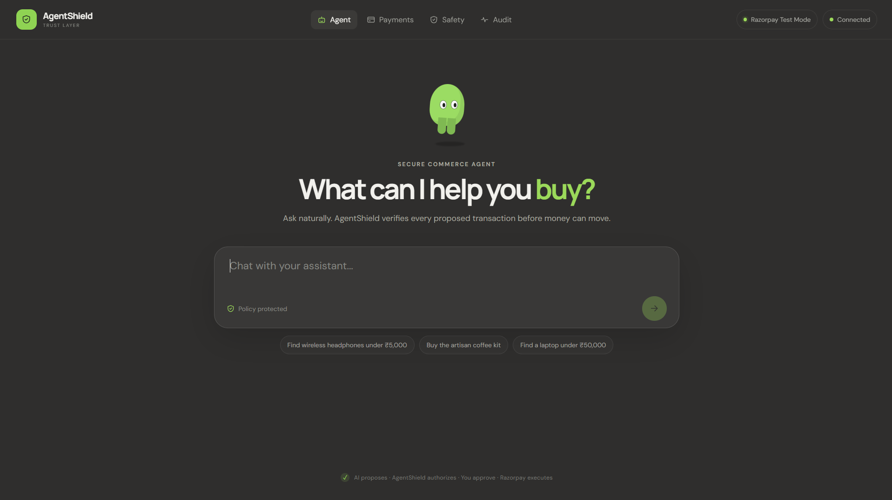

<p align="center">
  
</p>

<h1 align="center">AgentShield</h1>

<p align="center">
  <strong>Trust &amp; Authorization Layer for Agentic Commerce</strong>
</p>

<p align="center">
  AI can propose. Deterministic systems authorize. Humans approve. Payment providers execute.
</p>

<p align="center">
  <a href="#overview">Overview</a> ·
  <a href="#how-it-works">How It Works</a> ·
  <a href="#capabilities">Capabilities</a> ·
  <a href="#architecture">Architecture</a> ·
  <a href="#getting-started">Getting Started</a> ·
  <a href="#testing">Testing</a> ·
  <a href="#security-model">Security</a> ·
  <a href="./docs/DEVELOPMENT.md">Developer Guide</a> ·
  <a href="./docs/ARCHITECTURE.md">Architecture Details</a> ·
  <a href="./CONTRIBUTING.md">Contributing</a>
</p>

---

## Demo

<p align="center">
  <a href="https://youtu.be/rWPqCKrf7cY">
    
  </a>
</p>

<p align="center">
  <strong>▶ Watch the AgentShield Demo</strong>
</p>

The demo walks through the complete AgentShield flow end to end:

**Customer → AI Agent → Policy Validation → Human Approval → Razorpay Test Payment → Reconciliation → Audit Trail**

---

## Overview

AI agents are increasingly capable of discovering products, making recommendations, preparing orders, and initiating actions on behalf of users. Giving an agent unrestricted authority over financial operations, however, creates a difficult trust problem: how can an application benefit from agent reasoning without allowing a model to become the authority that moves money?

**AgentShield is an application-level trust and authorization layer for agentic commerce.** It separates AI-generated action proposals from deterministic policy decisions, human approval, and payment execution. The model can help understand a request and propose an action, but server-side application logic remains responsible for deciding whether that action is allowed and whether it can proceed to payment.

The project combines a React application, a Node.js/Express API, MongoDB persistence, an optional OpenAI-compatible model integration, and Razorpay Payment Links. It includes session-based authentication, role checks, CSRF protection, an approval workflow, payment reconciliation, webhook processing, and audit records.

> **Project status:** Active development. The repository contains a developed application, automated tests, local development infrastructure, and release documentation. It does not establish that a production deployment, live payment operation, or production operational controls have been verified. See [RELEASING.md](./RELEASING.md) before any production use.

## Why AgentShield?

An AI model is useful for interpreting customer intent and preparing structured proposals. It should not be trusted as the source of truth for transaction amounts, permissions, inventory, approval decisions, or payment status.

AgentShield introduces a boundary between reasoning and authorization:

- The **agent** interprets the request and proposes an action.
- The **policy layer** evaluates the proposal against server-side rules and authoritative data.
- An **authorized user** approves actions that require human review.
- The **payment service** validates the order state and communicates with the provider.
- **Reconciliation and audit services** help verify and explain the resulting state.

The central principle is simple: **AI proposes; deterministic application logic authorizes.**

## How It Works

```text
Customer request
       |
       v
AI agent / proposal generation
       |
       v
Structured action proposal
       |
       v
Deterministic policy evaluation
       |
       +------ BLOCK ------> Record outcome / audit
       |
       +------ REVIEW -----> Authorized human approval
       |
       +------ ALLOW ------> Continue according to policy
                                    |
                                    v
                           Server-side order validation
                                    |
                                    v
                           Payment link creation
                                    |
                                    v
                         Webhook / provider status lookup
                                    |
                                    v
                         Reconciliation and recovery
                                    |
                                    v
                                 Audit trail
```

The exact path depends on the policy result and approval requirements. The frontend is an interface, not the security boundary: authentication, authorization, CSRF validation, policy evaluation, and payment-state validation take place on the backend.

## Capabilities

### Agent-assisted commerce

- Conversational workflow for customer requests.
- Product discovery and recommendations from the application catalog.
- Structured action proposals instead of direct model-controlled payment execution.
- Optional OpenAI-compatible chat-completions integration.
- Deterministic fallback behavior when an LLM API key is not configured.

### Deterministic policy enforcement

- Server-side evaluation using product and merchant data.
- Validation of transaction constraints, product availability, discounts, and approval requirements.
- Explicit policy outcomes such as allow, block, or review.
- Role-based permissions for `admin`, `approver`, and `viewer` users.
- Human approval workflow for actions requiring authorization.

### Payment execution and reliability

- Razorpay Payment Link integration.
- Server-authoritative order totals; model-generated proposal amounts are not treated as the financial source of truth.
- Role-checked payment creation and duplicate-action protections.
- Webhook signature verification against the exact raw request body.
- Durable webhook event tracking and retryable processing states.
- Payment status reconciliation and recovery lookup before attempting another payment link.
- Conditional order-state transitions that prevent a late failure from moving an already-paid order backwards.

Webhook processing is designed for recoverable, at-least-once delivery with idempotency protections. It is **not distributed exactly-once processing**: order, action, audit, webhook, and provider operations are not one atomic transaction. For the detailed recovery and failure model, see [docs/ARCHITECTURE.md](./docs/ARCHITECTURE.md).

### Identity, visibility, and operations

- Server-side sessions persisted in MongoDB.
- Secure, HttpOnly, SameSite=Strict session cookie scoped to `/api`.
- CSRF validation for state-changing authenticated requests.
- Interactive user provisioning; there is no public self-registration endpoint.
- Audit history for important action and payment lifecycle events.
- Health endpoint that reports MongoDB readiness.
- Request IDs for correlating API responses with backend logs.
- Graceful shutdown handling for the HTTP server and MongoDB connection.

## Architecture

| Component         | Responsibility                                                                              | Technologies                          |
| ----------------- | ------------------------------------------------------------------------------------------- | ------------------------------------- |
| Web client        | Application UI, agent workspace, payments, audit, and simulation views                      | React, TypeScript, Vite, React Router |
| API server        | Authentication, authorization, policy enforcement, approvals, payments, webhooks, and audit | Node.js, Express, TypeScript          |
| Persistence       | Users, sessions, catalog, actions, orders, audit records, and webhook events                | MongoDB, Mongoose                     |
| Agent integration | Optional model-assisted conversation and structured proposal generation                     | OpenAI-compatible API                 |
| Payment provider  | Payment Links and payment-status verification                                               | Razorpay                              |

### Backend request and service boundaries

The backend is organized around configuration, middleware, routes, controllers, models, and domain services. Routes expose the HTTP API; controllers handle request/response concerns; services contain policy, agent, payment, recovery, webhook, catalog, and audit behavior. The frontend centralizes browser requests, session credentials, and CSRF-token handling in its API client.

For a deeper explanation of module responsibilities, request processing, and payment recovery, read [docs/ARCHITECTURE.md](./docs/ARCHITECTURE.md).

### Repository structure

```text
AgentShield/
├── client/
│   └── src/
│       ├── auth/             # Client authentication state
│       ├── layouts/          # Application layouts
│       ├── pages/            # Application pages and UI tests
│       └── services/         # Browser API client
├── server/
│   └── src/
│       ├── config/           # Environment, database, provider configuration
│       ├── controllers/      # HTTP request handlers
│       ├── middleware/       # Authentication, CSRF, logging, errors
│       ├── models/           # MongoDB/Mongoose models
│       ├── routes/           # API route registration
│       ├── scripts/          # User provisioning and seed utilities
│       ├── services/         # Agent, policy, payment, recovery, audit logic
│       └── tests/            # Backend tests
├── docs/
│   ├── ARCHITECTURE.md
│   └── DEVELOPMENT.md
├── .github/workflows/        # GitHub Actions CI
├── assets/                   # Project logo and demo media
├── compose.yaml              # Local development stack
├── AGENTSHIELD_SRS.md        # Software requirements specification
├── CONTRIBUTING.md
└── RELEASING.md              # Release-readiness and operator checklist
```

## Technology Stack

- **Frontend:** React 18, TypeScript, Vite, React Router
- **Backend:** Node.js, Express 4, TypeScript
- **Database:** MongoDB, Mongoose
- **AI integration:** Optional OpenAI-compatible chat-completions API
- **Payments:** Razorpay Payment Links
- **Testing:** Vitest, Testing Library, Node.js test runner, Monocart coverage
- **Tooling:** npm lockfiles, ESLint, TypeScript, Docker Compose, GitHub Actions

The CI workflow uses Node.js 22. For the complete local test toolchain, use Node.js 22.15 or newer. See [docs/DEVELOPMENT.md](./docs/DEVELOPMENT.md) for the supported development environment and detailed commands.

## Getting Started

### Prerequisites

- Node.js 22.15 or newer
- npm
- MongoDB 7.0 for local development, or Docker Desktop / Docker Engine with Docker Compose v2
- Razorpay Test Mode credentials only when making actual test-mode provider requests
- An OpenAI-compatible API key is optional

### 1. Clone the repository

```bash
git clone https://github.com/bhaveshdesale/AgentShield.git
cd AgentShield
```

### 2. Install dependencies

Install each package from its lockfile:

```bash
cd server
npm ci

cd ../client
npm ci
```

### 3. Configure the backend

Copy the backend example file:

```bash
cp server/.env.example server/.env
```

PowerShell equivalent:

```powershell
Copy-Item server\.env.example server\.env
```

At minimum, set `MONGODB_URI` to a local development database. The example configures `PORT=5050`, `CLIENT_URL=http://localhost:5173`, and `RAZORPAY_MODE=test`.

| Variable                       | Purpose                                                                                       |
| ------------------------------ | --------------------------------------------------------------------------------------------- |
| `NODE_ENV`                     | Runtime environment; production requires an HTTPS `CLIENT_URL` and an explicit Razorpay mode. |
| `PORT`                         | API listen port; defaults to `5000` when omitted.                                             |
| `MONGODB_URI`                  | Required MongoDB connection string.                                                           |
| `CLIENT_URL`                   | Allowed frontend origin; defaults to `http://localhost:5173`.                                 |
| `TRUST_PROXY_HOPS`             | Trusted proxy hop count; defaults to `0`. Set only for a known proxy topology.                |
| `LLM_API_KEY`                  | Optional model API key.                                                                       |
| `LLM_BASE_URL`                 | Optional OpenAI-compatible API base URL override.                                             |
| `LLM_MODEL`                    | Optional model name override.                                                                 |
| `LLM_TIMEOUT_MS`               | Optional model request timeout; defaults to `30000` ms.                                       |
| `RAZORPAY_MODE`                | `test` or `live`; production requires an explicit setting.                                    |
| `RAZORPAY_KEY_ID`              | Razorpay API key ID; required when creating a payment link.                                   |
| `RAZORPAY_KEY_SECRET`          | Matching Razorpay API key secret.                                                             |
| `RAZORPAY_TEST_WEBHOOK_SECRET` | Secret used to verify Test Mode webhook signatures.                                           |
| `RAZORPAY_LIVE_WEBHOOK_SECRET` | Secret used to verify Live Mode webhook signatures.                                           |

The model integration is optional. The API key variable is named `LLM_API_KEY`, not `OPENAI_API_KEY`. Without an LLM key, the backend uses its deterministic fallback. Razorpay credentials and webhook secrets are intentionally blank in the example file; payment-link creation and webhook verification require the corresponding credentials.

For local development, use a dedicated database such as:

```text
mongodb://127.0.0.1:27017/agentshield_dev
```

Keep test data in a separate disposable database, for example `agentshield_test`. Do not point development or test configuration at shared or production data.

### 4. Configure the frontend (optional)

The frontend defaults `VITE_API_BASE_URL` to `/api`. The Vite development server proxies this path to `http://localhost:5050`, so no frontend environment file is required for the default local setup.

To override the API base URL, copy `client/.env.example` to `client/.env` and set `VITE_API_BASE_URL`:

```bash
cp client/.env.example client/.env
```

**Security note:** Vite exposes `VITE_` variables in the browser bundle. Never put passwords, API keys, database URIs, or other secrets in frontend environment variables.

### 5. Provision the first administrator

There is no public self-registration endpoint. Create an initial local user with the interactive provisioning command:

```bash
cd server
npm run provision-user
```

Choose the `admin` role and enter a password when prompted. The CLI requires an interactive terminal and hides password input. Additional `approver` and `viewer` accounts can be provisioned the same way. Run this command only against the intended development database.

### 6. Start the backend

```bash
cd server
npm run dev
```

With the supplied example configuration, the API listens on `http://localhost:5050`. The health endpoint is available at `http://localhost:5050/api/health`; it returns HTTP `200` when MongoDB is connected and `503` otherwise.

### 7. Start the frontend

In a second terminal:

```bash
cd client
npm run dev
```

Open [http://localhost:5173](http://localhost:5173). The Vite development server forwards `/api` requests to the backend.

### Optional: seed local demo data

The seed script creates a demo merchant and catalog. **It deletes all merchant and product records in the database configured by `MONGODB_URI` before seeding.** Run it only against a fresh, disposable local development database. Never run it against shared, staging, or production data.

```bash
cd server
npm run seed
```

For platform-specific instructions and additional configuration notes, see [docs/DEVELOPMENT.md](./docs/DEVELOPMENT.md).

## Docker Compose

Docker Compose provides a local frontend, backend, and MongoDB stack. From the repository root:

```bash
docker compose up --build
```

Open [http://localhost:8080](http://localhost:8080). The browser sends `/api` requests to the frontend origin, and Nginx forwards them to the backend over the internal Compose network.

The Compose configuration uses a persistent MongoDB volume and Razorpay Test Mode defaults. The MongoDB service has no authentication and is intended for local development only. It is not a production database configuration and should not be used as the backend integration-test database.

Stop the stack with:

```bash
docker compose down
```

To remove the persistent MongoDB volume and all data stored in it:

```bash
docker compose down -v
```

Only run the latter after confirming that the local database contents are no longer needed. For diagnostics, use `docker compose ps`, `docker compose logs -f`, and `curl -i http://localhost:8080/api/health`.

## Testing

The repository provides root-level scripts for running the client and server suites:

```bash
npm test
npm run test:client
npm run test:server
```

The client tests run independently. The backend suite includes MongoDB-backed tests and requires a running, **disposable** test database. Use dummy Razorpay Test Mode values; provider interactions in automated tests are mocked. Never point test configuration at production, shared data, or the persistent Compose development database.

### Backend checks

Run from `server/`:

```bash
npm ci
npm run lint
npm run typecheck
npm run build
npm test
npm run test:coverage
npm audit --audit-level=low
```

Before backend tests, set `NODE_ENV=test`, `MONGODB_TEST_URI`, `MONGODB_URI`, and dummy Razorpay test variables. Example PowerShell setup, assuming a disposable MongoDB instance is available at `127.0.0.1:27017`:

```powershell
Set-Location server
$env:NODE_ENV = "test"
$env:MONGODB_TEST_URI = "mongodb://127.0.0.1:27017/agentshield_test"
$env:MONGODB_URI = $env:MONGODB_TEST_URI
$env:RAZORPAY_MODE = "test"
$env:RAZORPAY_KEY_ID = "rzp_test_local_dummy"
$env:RAZORPAY_KEY_SECRET = "local-dummy-api-secret"
$env:RAZORPAY_TEST_WEBHOOK_SECRET = "local-dummy-webhook-secret"
Remove-Item Env:LLM_API_KEY -ErrorAction SilentlyContinue
npm test
```

The example values are placeholders for local automated tests, not valid provider credentials.

### Frontend checks

Run from `client/`:

```bash
npm ci
npm run lint
npm run typecheck
npm test
npm run test:coverage
npm run build
npm audit --audit-level=low
```

### Continuous integration

The repository defines a GitHub Actions workflow at `.github/workflows/ci.yml`. It runs on pull requests and pushes to `main`, uses Node.js 22 and a MongoDB 7 service, installs dependencies with `npm ci`, and runs dependency audits, linting, typechecking, builds, and coverage-enabled tests.

A workflow definition is not evidence that the latest run passed. Check the [GitHub Actions runs](https://github.com/bhaveshdesale/AgentShield/actions) for the current result before treating CI as a release gate.

## API Overview

The backend currently exposes the following routes:

| Area           | Method | Endpoint                   | Access / purpose                                                                       |
| -------------- | ------ | -------------------------- | -------------------------------------------------------------------------------------- |
| Authentication | `POST` | `/api/auth/login`          | Start a user session.                                                                  |
| Authentication | `GET`  | `/api/auth/session`        | Retrieve the current session.                                                          |
| Authentication | `POST` | `/api/auth/logout`         | Revoke the current session; requires CSRF validation.                                  |
| Agent          | `POST` | `/api/agent/chat`          | Agent conversation; requires an `admin` or `approver` role.                            |
| Products       | `GET`  | `/api/products`            | List catalog products.                                                                 |
| Products       | `GET`  | `/api/products/:id`        | Retrieve a product.                                                                    |
| Actions        | `POST` | `/api/actions/validate`    | Validate a proposed action; requires an `admin` or `approver` role.                    |
| Actions        | `POST` | `/api/actions/approve`     | Approve an eligible action; requires an `admin` or `approver` role.                    |
| Payments       | `POST` | `/api/payments/create`     | Create a payment link for an eligible action; requires an `admin` or `approver` role.  |
| Payments       | `GET`  | `/api/payments`            | Retrieve payment/order history.                                                        |
| Payments       | `GET`  | `/api/payments/:id/status` | Retrieve the status of an order.                                                       |
| Webhooks       | `POST` | `/api/webhooks/razorpay`   | Receive Razorpay events; verifies the provider signature against the raw request body. |
| Audit          | `GET`  | `/api/audit`               | Retrieve audit history.                                                                |
| Dashboard      | `GET`  | `/api/dashboard/stats`     | Retrieve dashboard statistics.                                                         |
| Simulation     | `POST` | `/api/simulation/run`      | Run a safety simulation; requires an `admin` or `approver` role.                       |
| Health         | `GET`  | `/api/health`              | Check API and MongoDB readiness.                                                       |

Except for login, health, and the provider webhook route, application routes require an authenticated session. State-changing authenticated requests require a CSRF token. Role checks apply to privileged operations as noted above.

## Security Model

AgentShield separates responsibilities so that the model is not the authority for financial execution:

1. **Proposal:** The agent interprets a request and produces structured proposal data.
2. **Policy evaluation:** Server-side logic evaluates the proposal against application rules and authoritative data.
3. **Approval:** An authorized user approves actions that require human review.
4. **Execution:** The payment service validates the current order/action state and communicates with Razorpay.
5. **Verification and audit:** Webhooks and provider lookups help reconcile payment state; the application records relevant lifecycle events.

Implemented safeguards include session-based authentication, role checks, CSRF validation, Secure/HttpOnly/SameSite session cookies, server-side amount calculation, webhook signature verification, and conditional payment-state updates.

This is an application security design, not a claim of formal verification, independent security certification, or complete protection against every threat. Review the [release handoff](./RELEASING.md) before using the project with real users, sensitive data, or live payment traffic.

## Deployment and Operational Status

The repository includes Dockerfiles, a local Compose stack, CI configuration, environment examples, and a release-readiness guide. It does not include evidence of a verified production deployment or a production operations environment.

Production use requires separate configuration and verification of HTTPS, secrets, database network access and backups, provider credentials and webhook delivery, monitoring, rate-limit behavior across replicas, and rollback/data-recovery procedures. The current login rate limiter uses an in-process memory store; its state is not shared across backend replicas. See [RELEASING.md](./RELEASING.md) for the deployment checklist, known limitations, and operator responsibilities.

## Contributing

Contributions, bug reports, and documentation improvements are welcome.

- Read [CONTRIBUTING.md](./CONTRIBUTING.md) before opening a pull request.
- For significant features or architectural changes, open an issue to discuss the approach first.
- Include tests for changes to policy, authorization, payment, webhook, or recovery behavior.
- Never include real credentials, database URIs, access tokens, or `.env` files in commits or pull requests.

## Security Reports

Do not publish credentials, exploit details, or sensitive payment data in a public issue. Follow the private reporting guidance in [CONTRIBUTING.md](./CONTRIBUTING.md) and contact the maintainer privately.

## License

No `LICENSE` file is currently included in this repository. The repository is publicly viewable on GitHub, but public visibility does not itself grant permission for unrestricted use, modification, or redistribution. A formal open-source license must be added before those rights can be clearly granted.

## Acknowledgements

AgentShield was initially developed for the Razorpay AI Builder 2026 challenge in the AI Growth & Agentic Commerce track. The project continues to explore how agentic systems can participate in commerce while keeping authorization, human oversight, payment execution, and accountability within application-controlled boundaries.

---

<p align="center">
  <strong>AgentShield</strong><br />
  Trust before transaction.
</p>
